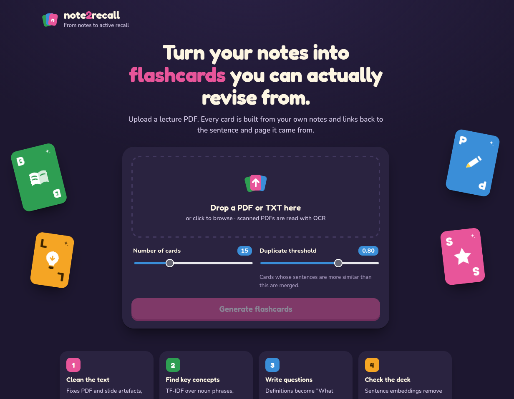
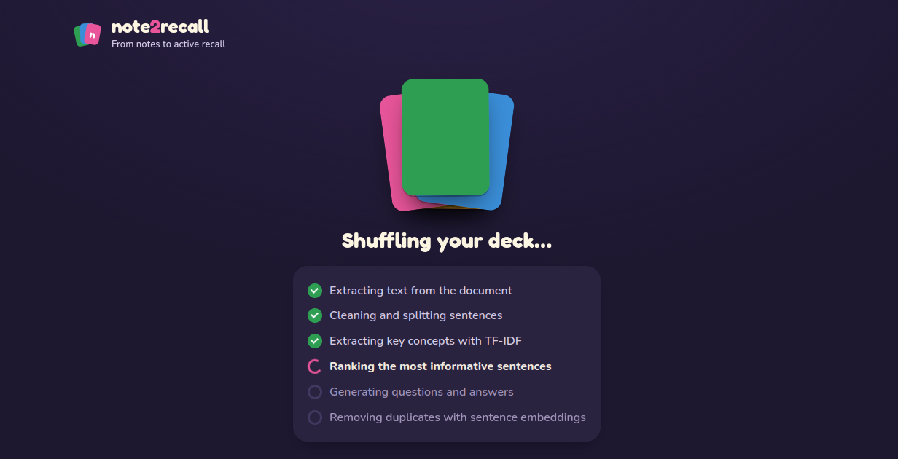
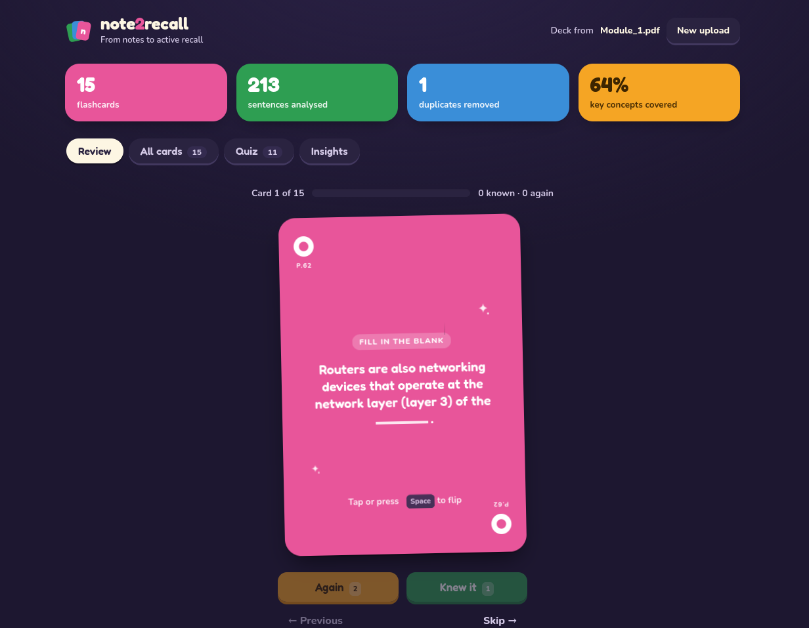
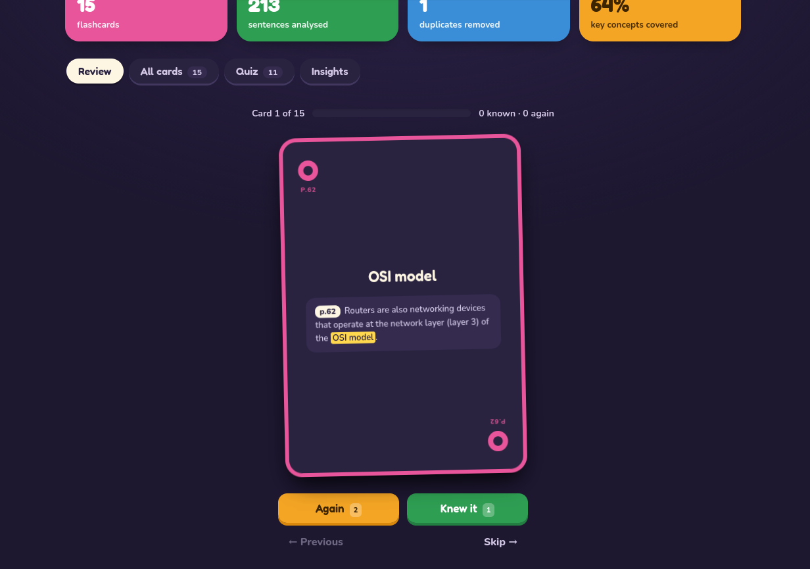
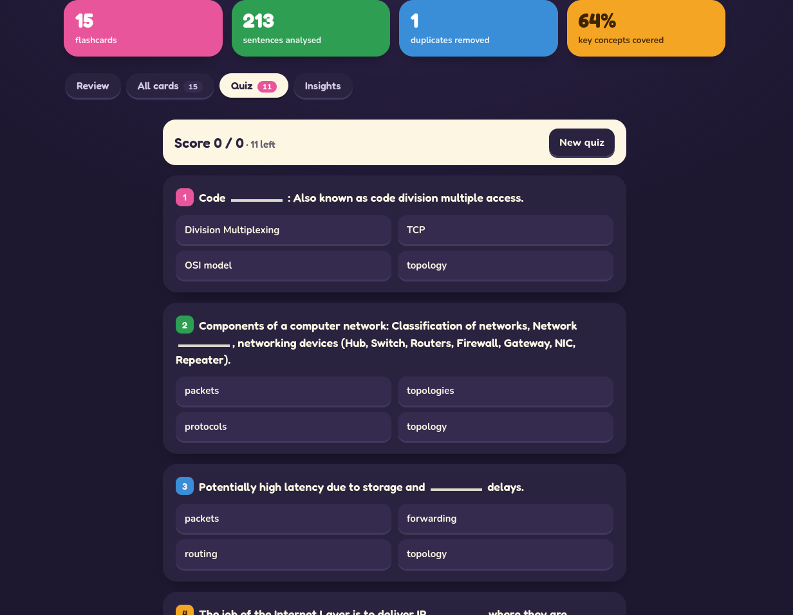
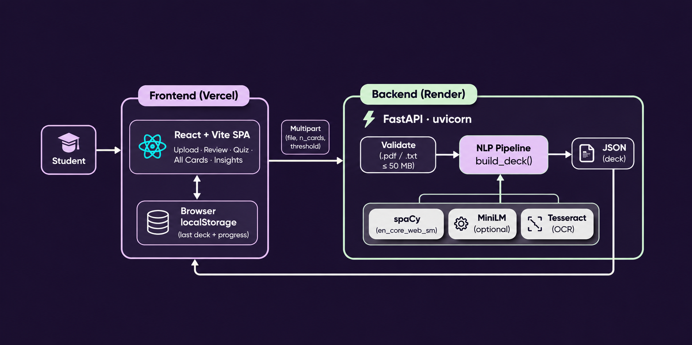

# note2recall

Upload study notes (PDF or text) and get flashcards for active recall. Every card is built from your own notes and links back to the sentence and page it came from.

NLP mini-project. The pipeline is traditional NLP and runs entirely locally: no LLM or API calls.

## Screenshots

<table>
  <tr>
    <td width="50%"></td>
    <td width="50%"></td>
  </tr>
  <tr>
    <td align="center"><b>Upload</b>: drop a PDF or TXT, choose the deck size</td>
    <td align="center"><b>Processing</b>: the NLP pipeline runs on the server</td>
  </tr>
  <tr>
    <td></td>
    <td></td>
  </tr>
  <tr>
    <td align="center"><b>Review</b>: question on the front</td>
    <td align="center"><b>Answer</b>: highlighted in the source sentence, with its page</td>
  </tr>
  <tr>
    <td colspan="2"></td>
  </tr>
  <tr>
    <td colspan="2" align="center"><b>Quiz</b>: multiple choice, with answers from the other cards as wrong options</td>
  </tr>
</table>

## Architecture



The React app sends the uploaded file to a FastAPI backend, which runs the NLP pipeline and returns the whole deck as JSON. There is no database: the browser keeps the last deck and review progress in `localStorage`. Step-by-step pipeline diagram: [docs/architecture.md](docs/architecture.md).

## How it works

| Step | Technique |
|---|---|
| Preprocessing | PDF text extraction (OCR for scanned pages), slide-aware line joining, repair of words glued together by PDF extraction, spaCy sentence splitting |
| Keyword extraction | TF-IDF over spaCy noun phrases, weighted by domain specificity (rarity in general English, from `wordfreq`) |
| Sentence ranking | Mean TF-IDF weight plus a bonus for each key concept the sentence contains |
| Question generation | Definition templates ("X is a Y" → "What is X?") and cloze deletion of key terms. Answers are spans of the source sentence. |
| Duplicate detection | Sentence embeddings (`all-MiniLM-L6-v2`) plus an acronym-aware same-concept check |
| Coverage | Key concepts that no card tests |

## Results

Tested on clean notes and two real Computer Networks lecture slide decks (78 and 118 pages):

- 100% of answers are found in their source sentence.
- 68–96% of the top 25 key concepts are covered by a 20-card deck.
- Duplicate detection on 20 labelled pairs: embeddings reach F1 0.80, TF-IDF reaches F1 0.56.

The full evaluation is in `SmartNotes.ipynb`, section 7.

## Project layout

```
smartnotes/pipeline.py   the NLP pipeline (build_deck is the entry point)
SmartNotes.ipynb         builds and evaluates the pipeline step by step
api.py                   FastAPI server for the React frontend
frontend/                React + Vite frontend
app.py                   alternative Streamlit frontend
evaluation/              labelled duplicate pairs, generated decks, ratings
docs/                    architecture diagrams
sample_notes.pdf / .txt  sample lecture notes for testing
```

## Setup

Requires Python 3.10+ and Node 18+.

```bash
python3 -m venv .venv
.venv/bin/pip install torch --index-url https://download.pytorch.org/whl/cpu
.venv/bin/pip install -r requirements.txt
.venv/bin/python -m spacy download en_core_web_sm

cd frontend && npm install && npm run build && cd ..
```

For scanned PDFs, also install Tesseract: `sudo apt install tesseract-ocr`.

## Run

```bash
.venv/bin/uvicorn api:app --port 8000        # React app → http://localhost:8000
.venv/bin/streamlit run app.py               # Streamlit app → http://localhost:8501
.venv/bin/jupyter notebook SmartNotes.ipynb  # notebook
```

While editing the frontend, run `npm run dev` in `frontend/` (→ http://localhost:5173) alongside the API server.

## Deploy

- **Backend:** `render.yaml` deploys the API from the `Dockerfile` to Render's free tier. The image is lite by default: it has OCR but uses TF-IDF for duplicate detection, so it fits in 512 MB of RAM. Build with `--build-arg EMBEDDINGS=1` for sentence embeddings (needs about 1.5 GB). Allowed frontend origins are set with `ALLOWED_ORIGINS` (comma-separated) or `ALLOWED_ORIGIN_REGEX`.
- **Frontend:** deploy `frontend/` to Vercel, with `VITE_API_URL` set to the backend URL.

## Limitations

- Questions come from templates, so about 12% of cards from slide decks are weak, mostly fill-in-the-blank cards built from slide fragments.
- OCR handles printed text only; handwriting is not supported.
- The duplicate threshold (0.80) was tuned on the same 20 pairs it is evaluated on.
