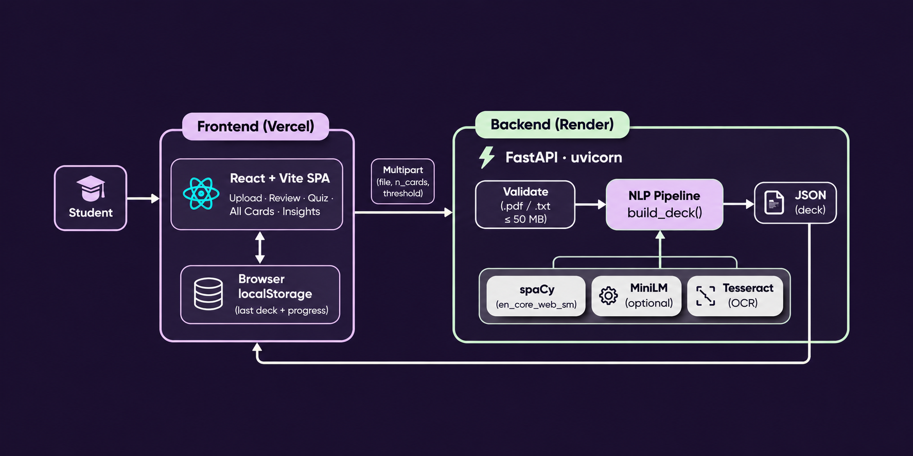
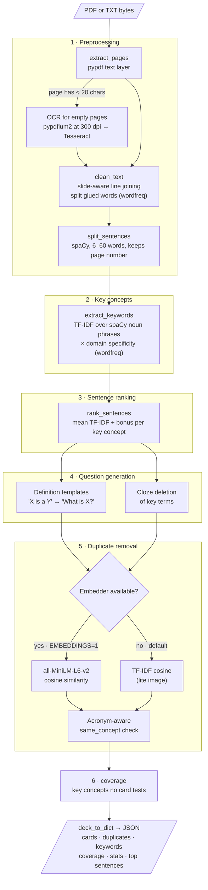

# note2recall architecture

## System overview

The React app runs in the browser and sends the uploaded file to the FastAPI backend. The backend runs the NLP pipeline and returns the whole deck as JSON. There is no database: the browser keeps the last deck and review progress in `localStorage`.

## NLP pipeline (`build_deck`)

Everything runs locally with traditional NLP: no LLM or external API calls.

## Deployment and local development

| | Production | Local |
|---|---|---|
| Frontend | Vercel, `VITE_API_URL` points at the Render backend | Vite dev server on `:5173`, which proxies `/api` to `:8000` |
| Backend | Render web service built from `Dockerfile` (`render.yaml`), health check on `/api/health` | `uvicorn api:app --port 8000`, which also serves `frontend/dist` |
| Image | Lite by default: OCR plus TF-IDF duplicates, fits in 512 MB. `--build-arg EMBEDDINGS=1` adds torch and MiniLM (about 1.5 GB) | Full `requirements.txt` with embeddings |
| CORS | `ALLOWED_ORIGIN_REGEX` matches `note2recall*.vercel.app` | `localhost:5173` is allowed by default |

`app.py` is an alternative Streamlit frontend that calls `build_deck()` directly, without the API.
